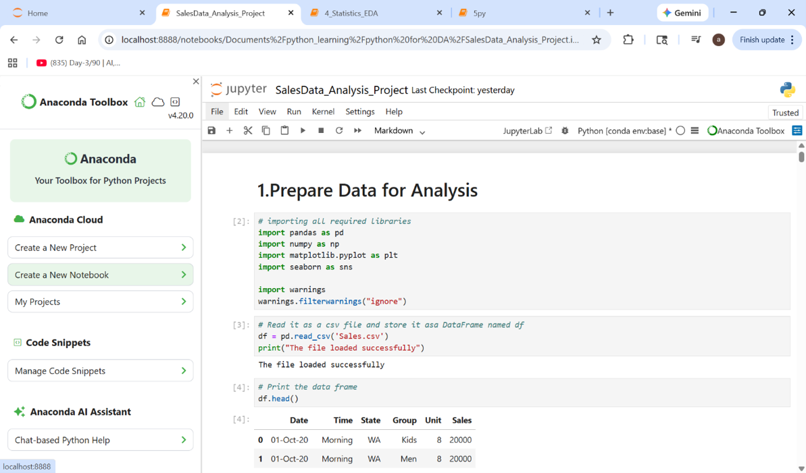
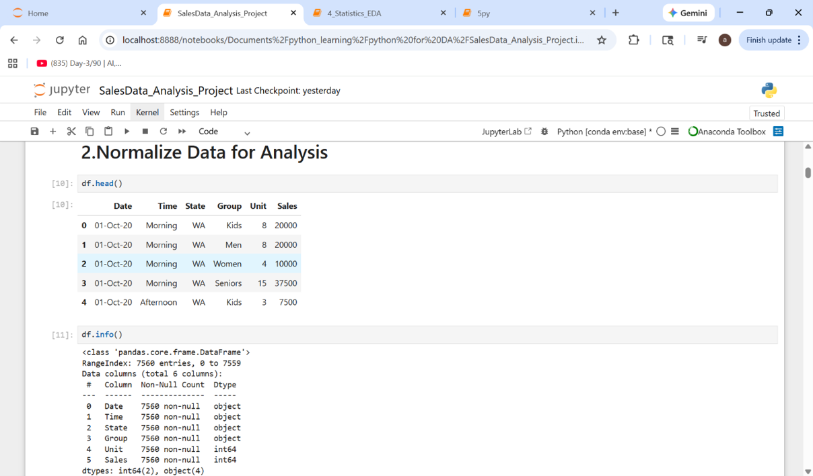
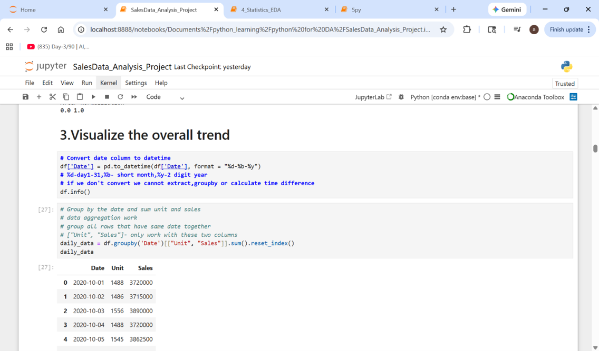
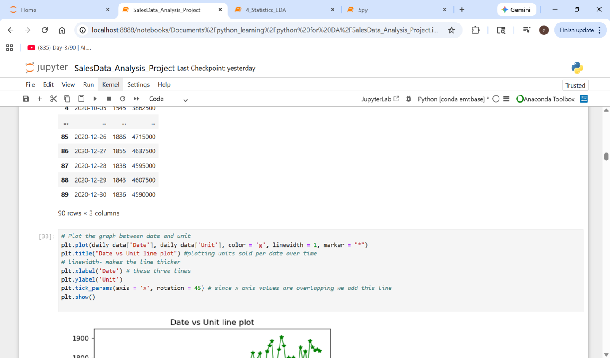
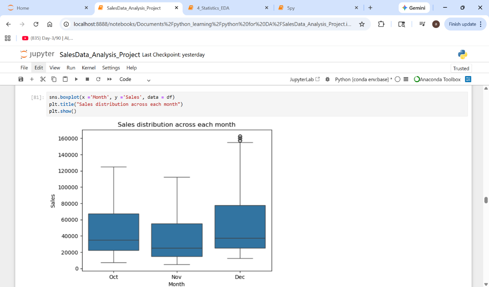
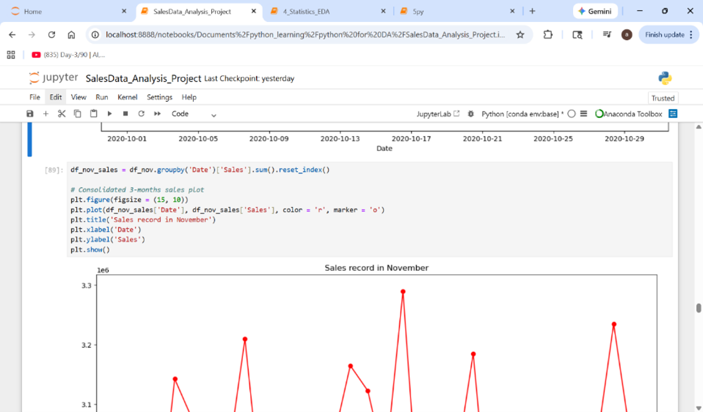
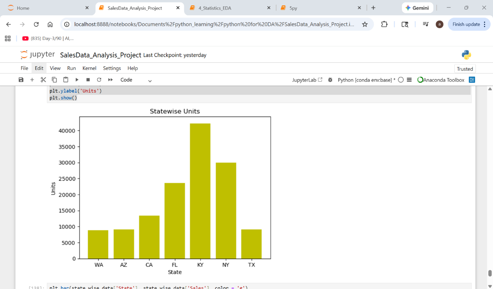

# Python Sales Data Analysis

## Project Overview

This project uses Python to analyze sales data, perform data cleaning, explore patterns, and develop insights through exploratory data analysis (EDA).

The dataset includes sales information such as date, time, state, customer group, units, and sales values.

## Tools and Technologies

- Python
- Pandas
- NumPy
- Matplotlib
- Seaborn
- Jupyter Notebook

## Project Objectives

1. Load and explore the sales dataset.
2. Check for missing values and examine data quality.
3. Perform exploratory data analysis.
4. Analyze sales patterns across states and customer groups.
5. Use data visualization to understand sales trends.

## Skills Demonstrated

- Data loading using Pandas
- Data cleaning and preparation
- DataFrame operations
- Grouping and aggregation
- Exploratory data analysis
- Data visualization

## Project Screenshots

### Screenshot 1

### Screenshot 2

### Screenshot 3

### Screenshot 4

### Screenshot 5

### Screenshot 6

### Screenshot 7

## Project Files

- [Python Jupyter Notebook](SalesData_Analysis_Project%20%281%29.ipynb)
- [Sales Dataset](Sales.csv)

## Conclusion

This project demonstrates foundational Python data analytics skills, including data cleaning, exploratory analysis, aggregation, and visualization of sales information.
